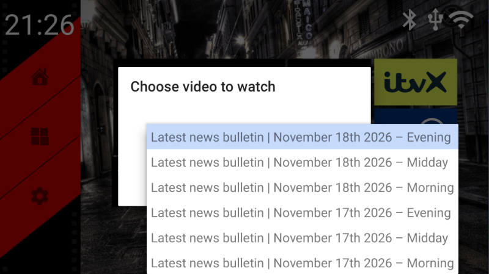

# TermuxRunner

TV launchers lack widgets. As an alternative, TermuxRunner allows you to pick and run [Termux](https://github.com/termux/termux-app/) user scripts using your remote. For example, [euronews-viewer](https://github.com/mycir/euronews-viewer)

|                  ​​​​​​​                                  |                                                 |
| :------------------------------------------------: | :---------------------------------------------: |
|  |  |
|   |   |

A release APK is available [here](https://github.com/mycir/TermuxRunner/releases/latest).

TermuxRunner is based on guidance and template code from [ChatGPT (OpenAI)](https://chatgpt.com/).

## Installation

Search for 'Install unknown apps' in Settings and allow.

Install the [apk](https://github.com/mycir/TermuxRunner/releases/latest) (build it yourself if you prefer).

The Termux:Widget plugin is not required, however, please treat [Termux:Widget - Setup Instructions](https://github.com/termux/termux-widget#setup-instructions) as applicable to TermuxRunner. NB If your device is running Android 10 or above, you must give TermuxRunner the [Draw Over Apps permission](https://github.com/termux/termux-widget#draw-over-apps-permission-optional). 

In Termux:
```
$ cp <path, e.g. /storage/emulated/0/Download>/termux-runner.sh /data/data/com.termux/files/home/.shortcuts/tasks
$ chmod 700 /data/data/com.termux/files/home/.shortcuts/tasks/termux-runner.sh
```

## Dependencies

In Termux:
```
$ pkg install file
```