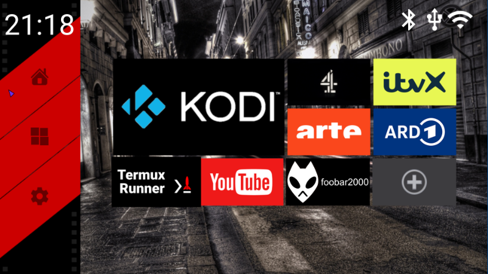
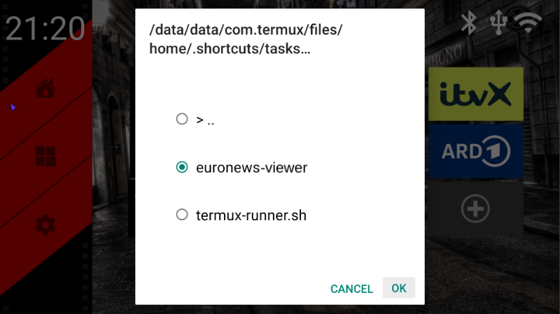
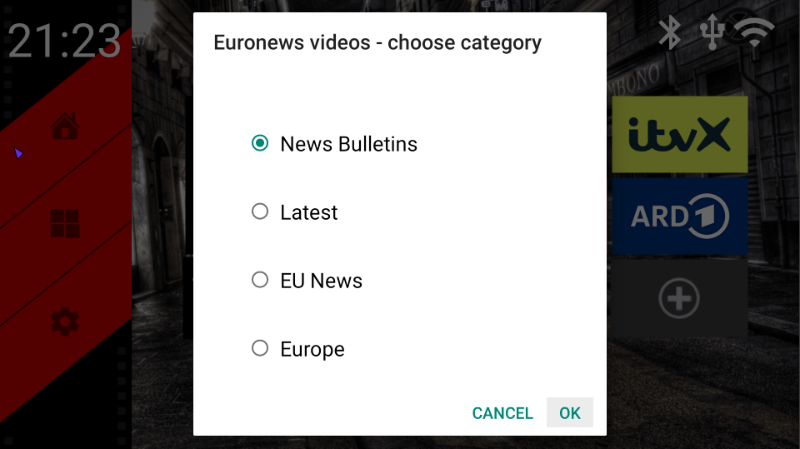

# TermuxRunner

TV launchers lack widgets. As an alternative, TermuxRunner allows you to pick and run [Termux](https://github.com/termux/termux-app/) user scripts using your remote. For example, [euronews-viewer](https://github.com/mycir/euronews-viewer)

|                  ​​​​​​​                                  |                                                 |
| :------------------------------------------------: | :---------------------------------------------: |
|  |  |
|   |   |

A release APK is available [here](https://github.com/mycir/TermuxRunner/releases/latest).

TermuxRunner is based on guidance and template code from [ChatGPT (OpenAI)](https://chatgpt.com/).

## Dependencies

[Termux](https://f-droid.org/en/packages/com.termux/)</br>
[Termux:API](https://f-droid.org/en/packages/com.termux.api/)</br>

In Termux:
```
$ pkg install termux-api file
```
## Installation

Search for 'Install unknown apps' in Settings and allow.

Install the TermuxRunner [apk](https://github.com/mycir/TermuxRunner/releases/latest).

Termux preparations, if not already done:

[Sharing Data (termux-setup-storage and allow-external-apps).](https://wiki.termux.com/wiki/Sharing_Data)</br>

The Termux:Widget plugin is not required, however, please treat [Termux:Widget - Setup Instructions](https://github.com/termux/termux-widget#setup-instructions) as applicable to TermuxRunner. NB If your device is running Android 10 or above, you must give TermuxRunner the [Draw Over Apps permission](https://github.com/termux/termux-widget#draw-over-apps-permission-optional). 

In Termux:
```
$ cp <path, e.g. ~/storage/downloads>/termux-runner.sh ~/.shortcuts/tasks
$ chmod 700 ~/.shortcuts/tasks/termux-runner.sh
```